# RENZ Clinic: UX/UI-разбор для сайта психолога

**Дата:** 30 октября 2026 года.  
**Источник:** https://renzclinic.ru/ — непосредственно открытая главная страница в Cloud Browser.  
**Статус:** исследованный кандидат; **НЕ утверждён пользователем**. Issue #2 остаётся открытым.  
**Объём проверки:** desktop визуально, DOM и фактический CSS; mobile — только анализ доступных CSS-правил.

## Достоверность и ограничения

Точный домен `renzclinic.ru` загрузился. Другие домены не использовались вместо него. Сайты Анастасии Колосковой и Артёма Праведного также открыты непосредственно в Cloud Browser, изучены первые экраны и информационные блоки.

Фактическое окно: `innerWidth = 1363`, `innerHeight = 936`; ширина основного контента — `1348 px`, с учётом полосы прокрутки. Это близкий к запрошенному desktop, но **не тест ровно на 1440 px**. Размеры ниже — CSS px, измеренные в этом окне, если не указано иное.

В доступном интерфейсе Cloud Browser нет управления viewport или эмуляции устройства; попытка вызвать режим устройства сочетанием клавиш не изменила страницу. **Визуальная проверка 390 и 320 px не выполнена, мобильных скриншотов нет.** Раздел о mobile основан на прочитанных правилах CSS. Расчёты размеров не подтверждают отсутствие переполнений, правильное кадрирование, работу touch, клавиатуры и нижней панели на телефоне. Скриншоты desktop не обрезались под видимость mobile.

Формы не отправлялись, персональные данные не вводились. Это референсный разбор, а не полный аудит доступности, производительности или всего сайта. Наличие стиля или DOM-элемента не считается доказательством работающего сценария.

## 1. Общее впечатление и характер

RENZ выглядит как современный брендовый сайт косметологии с элементами продуктового интерфейса: единый гротеск, ограниченная палитра, повторяющиеся скругления, короткие тексты и компактные элементы управления. Белый фон занимает большие области; пудровые поверхности отделяют карточки; тёмный бордовый одновременно работает как цвет текста, иконок, рамок и действия. Поэтому интерфейс ощущается собранным без множества разных графических приёмов.

Это не полностью нейтральный минимализм. Огромный логотип, видео на весь первый экран, стопки карточек, крупная фотография тела, асимметричный заголовок команды и большой брендовый футер добавляют рекламную театральность. Для нашей задачи полезнее **система компонентов**, чем весь художественный сценарий страницы.

Короткий контент хорошо соответствует запросу на воздух. Однако пустое пространство иногда достигнуто уменьшением текста и растягиванием прокрутки, а не только хорошей компоновкой. Воздушность и удобство чтения здесь следует оценивать отдельно.

## 2. UI-система: фактические параметры

### Палитра и поверхности

| Роль | Фактическое значение | Как работает |
|---|---|---|
| Основной фон | `--color-bg: #FFFFFF` | Большие нейтральные паузы между блоками |
| Текст и акцент | `--color-accent: #651D32` | Один тёмный цвет объединяет заголовки, CTA, контуры и иконки |
| Плашки и поля | `--color-badge: #EFEDEE` | Низкая визуальная громкость вторичных контролов |
| Основная розовая поверхность | `--color-surface: #FAEFF1` | Группирует фото и текст в предложениях |
| Фон карточек направлений | `rgb(250,245,245)` = `#FAF5F5` | Почти белая тёплая карточка без тяжёлой рамки |
| Hover акцент | `--color-btn-hover: #471926` | Более тёмное состояние кнопок |
| Граница | `--color-border: #D2D2D2` | Тонкие разделители и контуры полей |
| Вторичный текст | `--color-text-secondary: #A79198` | Номера и цены; выглядит деликатно, но контраст слабый |
| Градиент крупных панелей | `#FAEFF1 → #FFDFE5` | Даёт объём через цвет, без выраженных теней |

Из вычисленных сплошных цветов: бордовый на белом даёт контраст около **11,83:1**, вторичный `#A79198` на `#FAF5F5` — около **2,72:1**, на белом — **2,94:1**. Это расчёт пар цветов, не сертификат доступности всей страницы. Бледные небольшие цены и номера — плохой образец для переноса; важная информация должна быть контрастнее.

Для проекта сохраняем собственную палитру Dulux из `OPEN_DESIGN_BRIEF.md`. Из RENZ берём распределение ролей — светлый фон, отдельная поверхность, уверенный тёмный текст, один CTA-акцент. Бордовый и розовый не становятся новыми цветами проекта.

### Типографика

Основное семейство в CSS: `onest, system-ui, -apple-system, "Segoe UI", roboto, sans-serif`. Регистр имени в CSS именно такой. Большинство проверенных текстовых стилей имеют `font-weight: 500`.

| Элемент | Задано в CSS | Измерено на desktop |
|---|---|---|
| Базовый текст | `1.6rem / 1.4`, weight 500 | `11.23 / 15.73 px` |
| H1, заголовок направлений | `5.6rem / .95`, tracking `-.04em` | `39.32 / 37.35 px` |
| Заголовки карточек услуг | `4.8rem / .95`, tracking `-.03em` | `33.70 / 32.02 px` |
| Заголовок блока помощи | `4.8rem / .95` | `33.70 / 32.02 px` |
| Заголовки карточек запросов | `4rem / .95`, tracking `-.03em` | `28.08 / 26.68 px`, до анимационного transform |
| Заголовок предложения | `3.2rem / 1.1`, tracking `-.03em` | около `22.47 / 24.71 px` |
| Огромные части заголовка команды | `10rem / .85`, tracking `-.06em` | около `70.21 / 59.68 px` |
| Текст основной CTA | `1.8rem / .9`, weight 500 | около `12.64 px` |

Важная особенность: `html { font-size: calc(0.520833vw) }`. Интерфейс масштабируется пропорционально ширине. В текущем окне `1rem ≈ 7.02px`, а не привычные 16px. Поэтому номинальные `5.6rem` не означают гигантские 89.6px.

Сжатая межстрочная высота и отрицательный трекинг делают заголовки графичными. Но маленькие описания на desktop читаются хуже, чем выглядит общая композиция. Переносить нужно **контраст размеров и одно семейство**, а не линейное уменьшение всех rem. Для нового сайта разумная отправная точка — основной текст 16–18px, заголовки с ограниченным плавным масштабированием, нормальный интерлиньяж текста около 1.45–1.6. Это рекомендация, не измерение RENZ.

### Сетка, поля, радиусы

| Параметр | CSS / измерение | Вывод |
|---|---|---|
| Основная ширина | Почти во всю страницу; отдельного общего контейнера 1200px на главной не обнаружено | Выразительная широкая композиция, но на разных экранах всё масштабируется |
| Боковые поля большинства секций | `2.4rem ≈ 16.85px` | Тонкая наружная рамка, воздух преимущественно внутри секций |
| Первый экран | `height:100dvh; min-height:70rem`; две почти равные зоны | В текущем окне высота 936px; текст и CTA внизу слева |
| Промежуток колонок hero | `2.5rem ≈ 17.55px` | Фото и текст воспринимаются как соседние панели |
| Верхние паузы секций | Часто `20rem ≈ 140.42px` | Уверенный вертикальный ритм |
| Три карточки услуг | Каждая около `430.4 × 515.4px`, gap `1.65rem ≈ 11.58px` | Равные размеры и порядок информации облегчают сравнение |
| Скругления карточек/панелей | `1.6rem ≈ 11.23px` | Один умеренный радиус на разных компонентах |
| Медиа hero | `1.6rem 0 0 1.6rem` | Фото примыкает к правому краю, скруглено со стороны текста |
| Кнопка | Label `height:6rem ≈ 42.13px`, radius `5.8rem ≈ 40.72px`; круг-стрелка тоже `6rem` | Цельный повторяемый знак действия |
| Круглые действия навигации | `4rem ≈ 28.08px`, radius `50%` | Визуально компактно; маленькие цели для клика |
| Тени | У проверенных hero/карточек направлений `box-shadow:none` | Иерархия строится цветом и пространством, а не объёмными тенями |

Для сайта психолога не нужно превращать все секции в одинаковые карточки. Достаточно общего масштаба радиусов и отступов: текстовые секции могут оставаться открытыми, а условия услуги — собираться в поверхность.

## 3. Desktop, адаптивные правила и иллюстрации

### Первый экран — D1

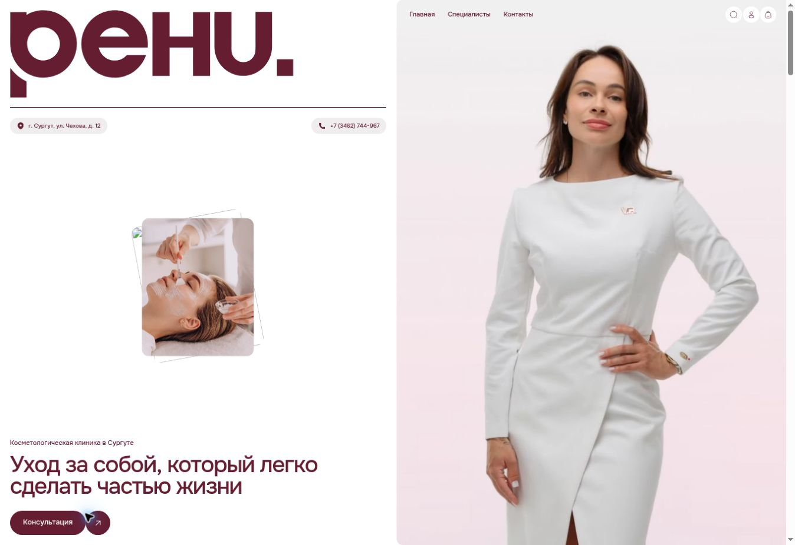

Слева огромный знак бренда, линия и контактные плашки; в середине — небольшая интерактивная стопка фото; внизу — категория, двухстрочный H1 и CTA. Справа не просто фотография, а **автоматически воспроизводимое зацикленное видео без звука и видимых controls**. Это подтверждено DOM и изменением кадров.

Работают крупная человеческая фигура, спокойный фон и маленькое число смысловых объектов. Слабее работает приоритет: бренд и изображение заметнее сути предложения. Cookie-плашка при первом посещении перекрывала часть нижнего текста; D1 снят после её отклонения. У психолога имя, специализация, формат и запись должны считываться раньше декоративного блока.

### Направления — D2

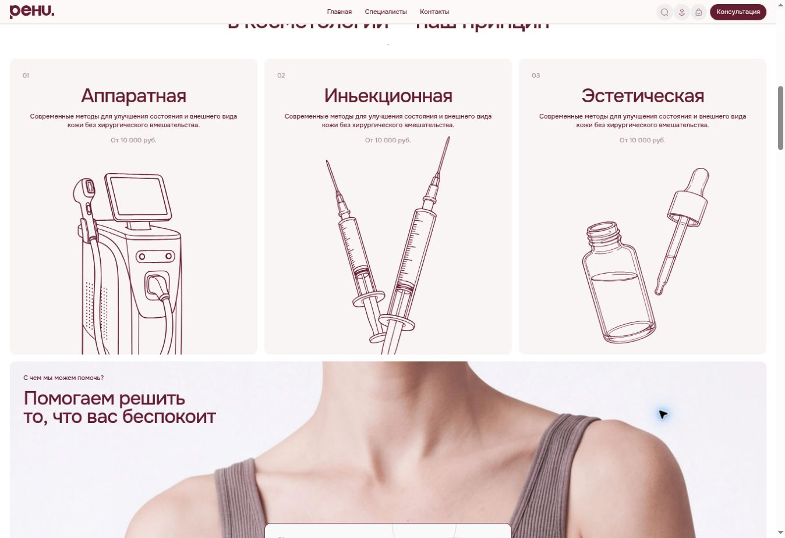

Три равные карточки: номер → крупное название → короткое описание → цена → большая монохромная контурная иллюстрация. Иллюстрации используют тот же бордовый и не вводят новую палитру. Они обрезаны краем карточки, отчего композиция кажется крупнее и менее похожей на каталог иконок.

Однако текст описаний и цена одинаковы во всех трёх карточках. Это не помогает понять разницу направлений. Есть опечатка «Иньекционная». Клик по заголовку первой карточки и по её кнопке «Подробнее: Аппаратная» не открыл страницу или диалог; URL и видимое состояние не изменились. Это наблюдение об одном проверенном направлении, не доказательство неисправности всех услуг сайта.

### Запросы — D3

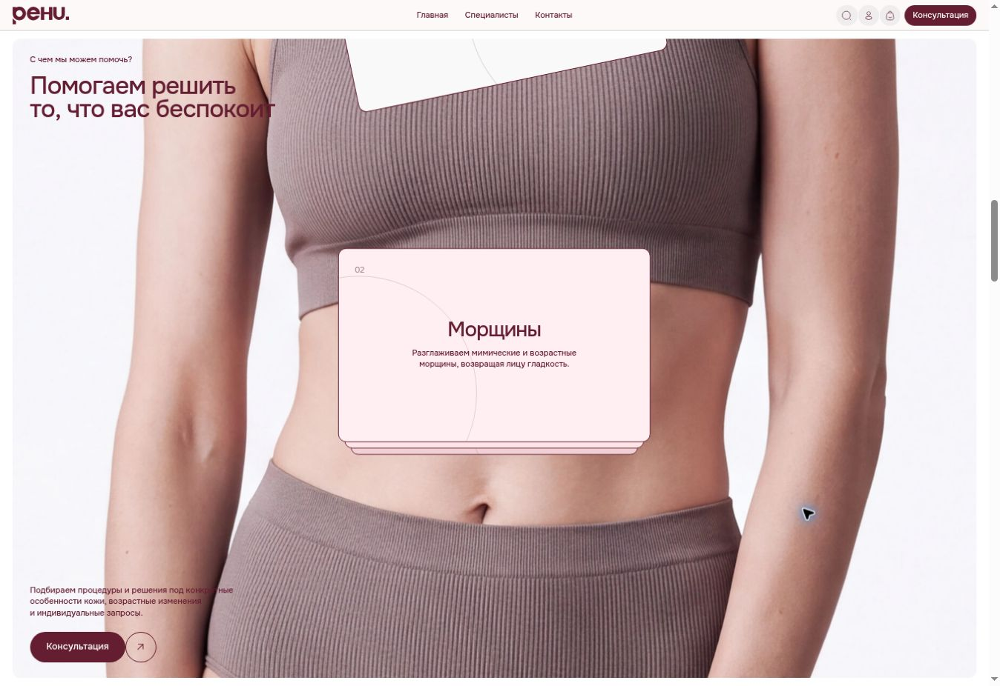

Большая фотография служит фоном, а поверх неё меняется стопка карточек. CSS: sticky-панель и три шага прокрутки по `75vh`; общая высота секции в текущем окне около **2977px**. Карточки анимируются во время скролла; в D3 виден кадр этого сценария, включая уходящую карточку сверху.

Подача запоминается, но список невозможно быстро окинуть взглядом. Текст в углах местами ложится на более тёмную часть фото. Для пользователя, выбирающего психолога, явный список запросов полезнее такого последовательного раскрытия. Это пример для обсуждения ограничений, а не рекомендуемая механика.

### Предложения и переходы — D4

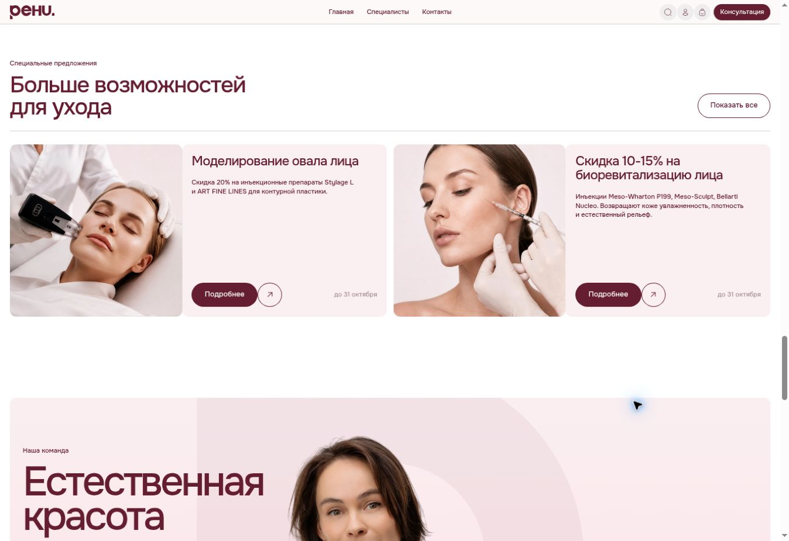

Каждое предложение — пара «квадратное фото + светлая текстовая поверхность». Две пары размещены в одном ряду. Кнопки находятся на одной нижней линии, дата отнесена к краю. Маленькая надпись над H2 задаёт контекст, а действие «Показать все» располагается справа от заголовка. Разделитель, пауза и смена типа композиции позволяют увидеть начало новой темы без большого цветного фона на всю страницу.

### Портретная панель — D5

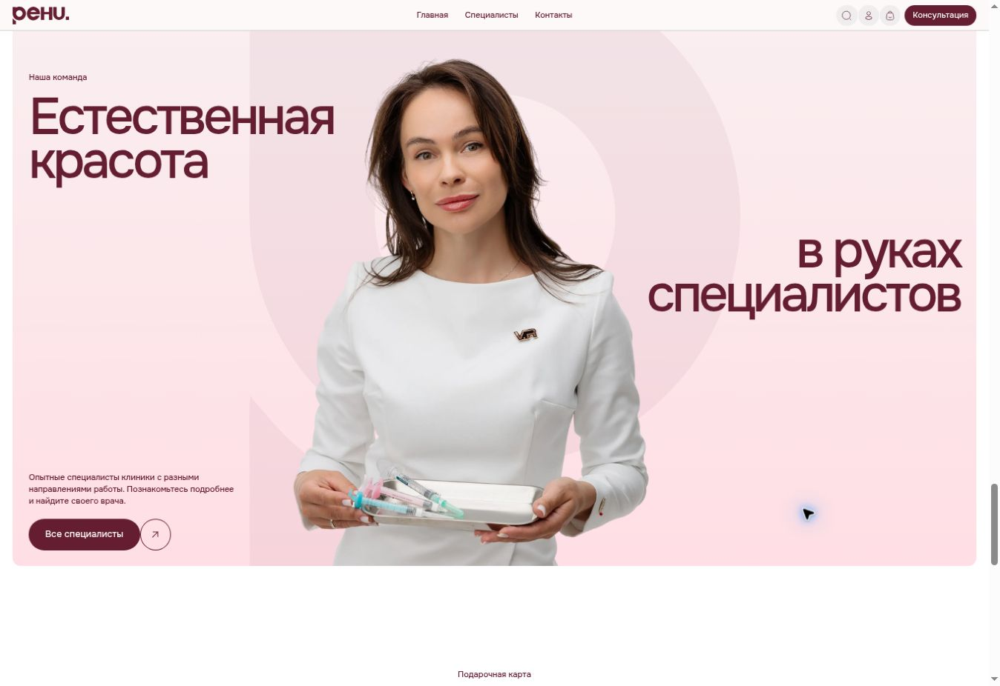

Портрет объединён с фирменной геометрией и очень крупной типографикой. Слова заголовка расположены по разные стороны фотографии. Выразительный брендовый приём, но он ближе к рекламному плакату, чем к рациональному UI. Для нашего сайта полезны согласованность фото и фона, единая рамка панели. Разнесённые слова, огромный знак и повторное доминирование портрета переносить не стоит.

### Запись — D6

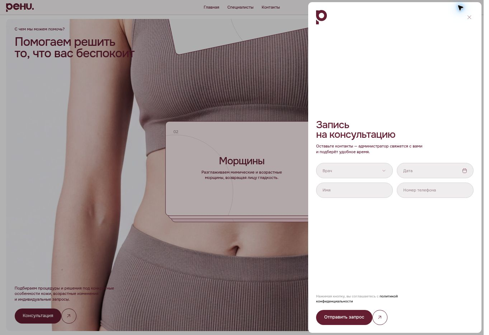

CTA действительно открывает боковую панель с затемнением страницы. Видны заголовок, пояснение о звонке администратора, выбор врача и даты, имя и телефон, кнопка отправки. Escape закрыл окно; после завершения перехода фокус вернулся на страницу. Доставка заявки, ошибки валидации и полный цикл клавиатурной навигации не проверялись.

Понятное описание следующего шага уменьшает неопределённость. Но высокая панель и разнесённые по высоте элементы создают много пустоты; поля в две колонки мелковаты. Для одного специалиста выбор врача лишний; канал записи и набор полей определим по брифу.

### Нижняя часть — D7

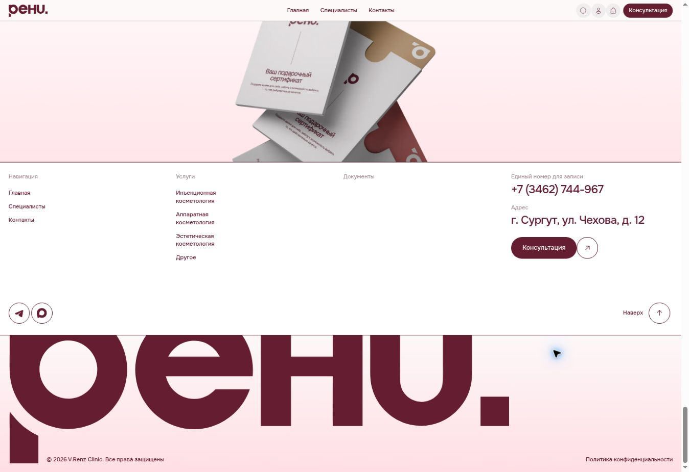

Контакты визуально крупнее служебной навигации, CTA повторён в ожидаемом месте. Тонкие линии связывают футер с первым экраном. Затем снова появляется огромный логотип. У персонального сайта полезны контактная иерархия и последнее понятное действие. Многоколоночная карта клиники и столь крупный брендовый финал избыточны.

### Mobile: подтверждено CSS, НЕ визуальным тестом

Главный breakpoint — **1024px**. Ниже него:

- Hero перестраивается в колонку: компактный логотип → медиа → текст. У медиа скругления со всех сторон. Контакты, разделитель, стопка фотографий и верхняя навигация скрываются.
- Локальная кнопка hero скрыта; внизу появляется фиксированная панель с CTA и группой иконок. Учтён `env(safe-area-inset-bottom)`. Нельзя считать проверенным, что она нигде не закрывает контент.
- Три карточки направлений переходят в вертикальный список, каждая получает высоту `45.6rem`. Это не горизонтальная карусель.
- Предложения тоже становятся колонкой: изображение над текстом; часть действий заменяется компактной кнопкой-иконкой.
- У команды элементы становятся последовательными, но портрет остаётся крупным с заданными размерами. Его реальное кадрирование на 390/320px не подтверждено.
- Sticky-сценарий запросов сохраняется; footer секции помощи скрывается. Следовательно, сложная механика не убрана автоматически ради mobile.
- Есть CSS-правила `prefers-reduced-motion` для сокращения переходов и отключения sticky у помощи/части футера. Это положительный технический сигнал; воспроизведение видео и реальное поведение JS в этом режиме отдельно не проверялись.

`html` ниже breakpoint: `font-size:min(2.66667vw,16px)`. Ниже — математическая оценка при соответствующей CSS-ширине без дополнительного gutter, **не значения снятого mobile-экрана**:

| Параметр | 390px | 320px |
|---|---:|---:|
| 1rem | 10.40px | 8.53px |
| Частый мобильный текст 1.4rem | 14.56px | 11.95px |
| H1 3.1rem | 32.24px | 26.45px |
| Боковое поле 1.6rem | 16.64px | 13.65px |
| Радиус 1.6rem | 16.64px | 13.65px |
| Высота карточки направления 45.6rem | 474.24px | 389.12px |
| Нижний CTA 5.5rem | 57.20px | 46.93px |
| Иконка-цель нижней панели 4.1rem | 42.64px | 34.99px |

Вероятная проблема на 320px — слишком мелкий текст и уменьшающиеся цели касания. Это обоснованный риск по формулам CSS, но не установленный визуальным тестом дефект. Для нашего сайта следует задавать нижние пределы размера текста и интерактивных целей, а не масштабировать всё пропорционально ширине.

## 4. Конкретные паттерны для рассмотрения

| Элемент | Как реализован на RENZ | Почему работает / ограничение | Применимость к психологу |
|---|---|---|---|
| Единый гротеск | Onest, преимущественно weight 500; размер и трекинг создают иерархию | Последовательный характер без декоративной пары шрифтов; малый текст требует увеличения | **Да:** одно выразительное sans-serif семейство |
| Поверхности без тяжёлых теней | Белое поле + почти белые карточки + более насыщенная большая панель | Группировка остаётся очевидной без визуального шума | **Да:** адаптировать роли к Dulux |
| Общий радиус | 1.6rem у карточек, фото и панелей | Разные блоки ощущаются частями одной системы | **Да:** ограниченный набор радиусов, с учётом масштаба блока |
| Маленькая подпись + H2 | Контекст над коротким крупным заголовком | Разделяет тип блока и его основной смысл; не нужны длинные вступления | **Да:** подписи должны добавлять смысл, а не повторять H2 |
| Равные карточки услуг | Повторяются положение названия, описания и цены | Быстро сравниваются, но одинаковые описания обесценивают сравнение | **Да:** реальные отличия формата, длительности и стоимости |
| Фото рядом с текстовой панелью | Два сопряжённых блока с похожими радиусами | Фотография даёт эмоцию, текст остаётся на читаемой поверхности | **Да:** особенно для «Обо мне»; не тиражировать одно фото везде |
| Повторяемый CTA | Капсула с подписью и прилегающим кругом-стрелкой | Узнаваемое действие; сложнее и декоративнее обычной кнопки | **Частично:** единая подпись и стиль важнее точного силуэта RENZ |
| Навигация после прокрутки | Компактная верхняя шапка с CTA вместо большого логотипа | Сохраняет доступ к записи; шрифт/иконки мелкие | **Да:** 3–4 якоря и доступная кнопка, без кабинета/корзины |
| Мобильная нижняя запись | Фиксированная CTA и группа иконок, safe-area в CSS | Может облегчить действие одной рукой, но перегружает низ | **Условно:** проверить на реальном mobile; возможно одна кнопка |
| Управление движением | Небольшие hover-переходы и reduced-motion CSS | Обратная связь полезна; длинная анимационная прокрутка мешает сканированию | **Частично:** короткие состояния, без обязательной анимации чтения |

## 5. UX, слабые места и границы переноса

**Навигация.** В первом экране три текстовые ссылки и три иконки. После прокрутки появляется компактная шапка с записью. Для клиники поиск, кабинет и корзина имеют понятный предметный контекст; одностраничнику психолога они не нужны. Ссылка «Специалисты» в навигации ведёт на `/specialists/`, а «Все специалисты» в секции команды — на `/doctors/`. Это различие наблюдается в DOM; доступность и содержимое обеих страниц не проверялись, поэтому не называем его сломанной навигацией.

**Сценарий.** Главная ведёт от образа бренда к направлениям, запросам, акциям, команде и подарочной карте. На всём пути есть повторные CTA. Однако акции и подарки усиливают розничную косметологическую логику. Для психолога важнее понять подход, совместимость, условия и следующий шаг.

**Интерактивность.** У карточки направления CSS показывает стрелку при hover с `scale(0) → scale(1.06667)`, градиент фона и лёгкий zoom иллюстрации `1.0229`, длительность около 0.5s. У кнопок — заливка круглой стрелки; у `.slide-anim` — движение дублированного текста около 0.4s. Это точные стили, а не все визуально проигранные состояния. Одного курсора pointer недостаточно: проверенная кнопка услуги результата не дала.

**Читаемость.** Главный бордовый хорошо контрастирует с белым, но малые размеры и бледные цены ослабляют пользу. В блоке помощи фон под текстом меняется вместе с фотографией; отдельная нейтральная подложка надёжнее.

**Движение.** Видео без видимых controls и длинная sticky-секция требуют отдельной проверки комфорта. Наличие reduced-motion CSS не доказывает, что все источники движения корректно отключаются. Мы не переносим этот сценарий в новый проект.

**Качество контента и ресурсов.** Один из hero-ресурсов `assets/facial-massage.webp` оставался без `naturalWidth`; при этом передняя фотография стопки отображалась. Отмечаем конкретный незагрузившийся ресурс, не утверждаем, что не загружаются все изображения. Пустая колонка «Документы» в футере и одинаковые тексты направлений дают ощущение недозаполненности.

**Главный риск копирования:** получить визуально приятный, но слишком рекламный и неудобный одностраничник. Человеческий контакт психолога не должен зависеть от эффектной прокрутки или постановочной клинической эстетики.

## 6. Сравнение с двумя выбранными сайтами

Сравнение основано на текущих desktop-страницах. Оно не отменяет выбор пользователя и не является mobile-аудитом этих двух сайтов.

| Критерий | RENZ Clinic | Анастасия Колоскова | Артём Праведный |
|---|---|---|---|
| Характер | Современный бренд косметологии, интерфейсные компоненты | Спокойная личная, редакционная подача | Профессиональный личный сайт с ясным предложением |
| Первый экран | Большой логотип, видео, смысл и CTA внизу | Две равные прямоугольные панели: имя/описание и интерьерный портрет | Имя, онлайн-формат, список помощи, CTA слева; крупный портрет справа |
| Типографика | Последовательный Onest sans-serif | Выраженные заголовки с засечками, курсивные подписи, текст Roboto; в стилях также встречается Vollkorn | Montserrat, крупное имя, более привычная иерархия |
| Минимализм | Мало текста, много движения и брендовой графики | Много свободных зон и простых прямоугольников; тексты в ряде блоков длиннее | Умеренно чисто, но есть фоновая графика мозга и больше информационных секций |
| Иерархия | Очень сильная на уровне секций, слабее на уровне маленьких описаний | Название и портрет доминируют; содержание про отношения и подход | Быстрее считываются специалист, формат и действие |
| Количество текста | На главной заметно меньше | Развёрнутое описание работы, карточки ценностей и запросов | Подробное образование, опыт и особенно объяснение разовой консультации |
| Скругления | Системно на большинстве поверхностей | Крупные блоки и фото преимущественно прямоугольные; CTA-капсулы | Скруглённые фото и большая белая панель; кнопка первого экрана ближе к прямоугольной |
| Фото | Полированная клиническая эстетика, видео, модельные сцены процедур | Живой кабинет и спокойный портрет; чувствуется личное пространство | Крупный герой и серия профессиональных портретов, в том числе тёмных |
| Что брать | Системность, поверхности, радиусы, короткие блоки | Человечность, кабинетную фотографию, объяснение подхода, FAQ | Порядок информации первого экрана, явные форматы, компетенции |
| Что не объединять | Розовую палитру, медицинскую графику, scroll-стопки | Serif и курсивы, длинные тексты только ради атмосферы | Длинное меню, фоновый мозг, объёмные объяснения и галерею всех дипломов |

### Иллюстрации сравнения

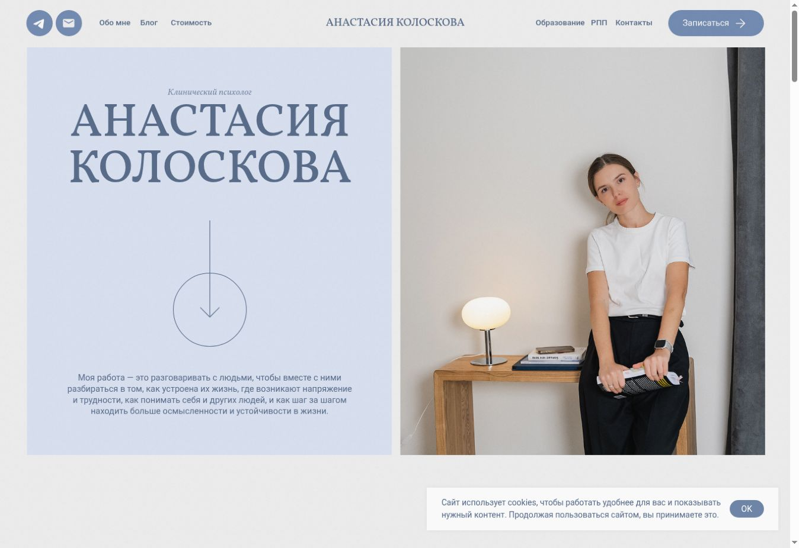

Равные площади текста и портрета дают спокойную композицию. Сайт действительно использует засечки: сохранять его в референсах можно за атмосферу и структуру, не перенимая весь шрифтовой стиль.

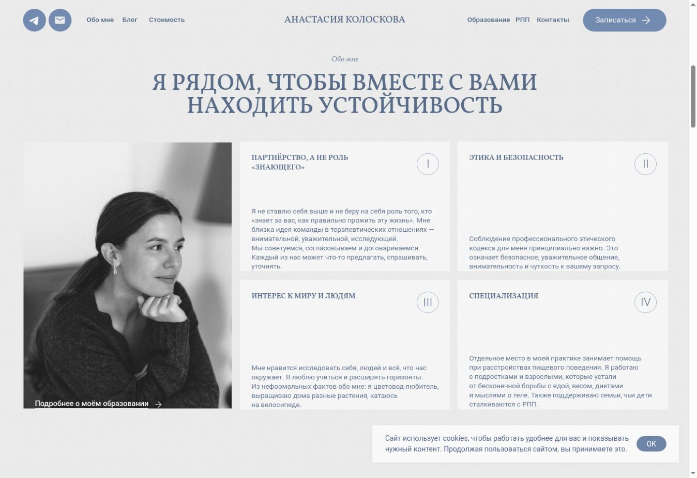

Человеческие принципы представлены отдельными темами, но нижняя часть карточек занята довольно длинными абзацами. Полезен сам принцип группировки, а объём текста можно сократить.

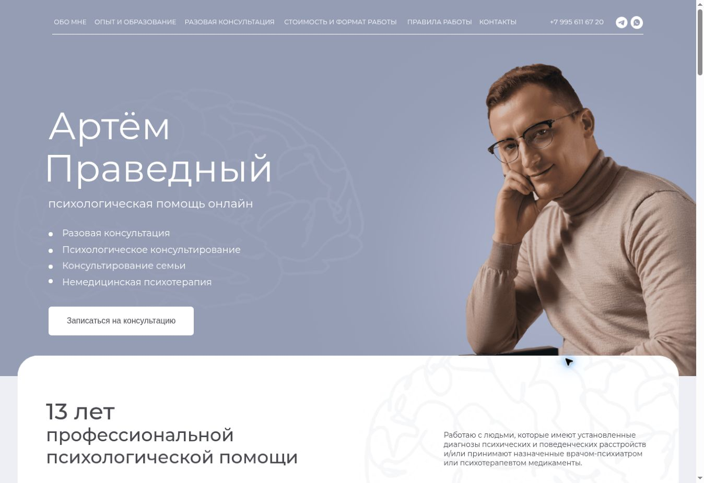

Здесь раньше появляется ответ «кто, какой формат, как записаться». На первом снимке портрет ещё не был виден; в отчёт включён последующий кадр, где он загрузился. Это не дефект отсутствующей фотографии.

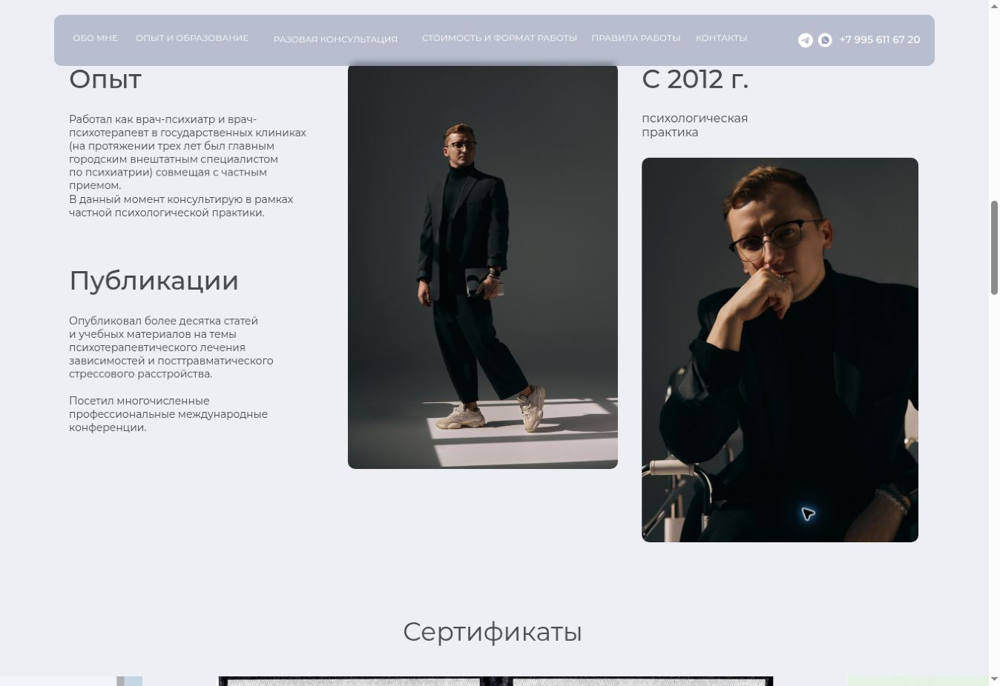

Профессиональные факты и разные ракурсы помогают представить человека. Для нашего минимализма двух портретов рядом и дополнительных фоновых метафор уже может быть слишком много.

**Как соединить принципы:** общий UI-язык выбрать один; смысловую последовательность и тон брать независимо от оформления. Не смешивать в одном макете serif Колосковой, Montserrat Праведного и плотный Onest RENZ как три равноправные стилистики. Собственная Dulux-палитра остаётся общей основой.

## 7. Адаптация восьми секций сайта психолога

Все формулировки ниже — рекомендации по структуре. Реальные специализация, опыт, методы, услуги, цены, фотографии и канал записи ещё не подтверждены клиентским брифом.

| Секция | Как применить принципы | Что сохранить видимым / чего избегать |
|---|---|---|
| 1. Первый экран с портретом | Две ясные зоны: компактный текстовый блок и крупный живой портрет в аккуратной рамке; один основной CTA | Имя, специализация, формат и запись — в первом экране. Не нужен гигантский логотип, стопка декоративных фото или обязательное видео |
| 2. С какими запросами работаю | 4–6 коротких карточек по реальным направлениям; заголовок и одно пояснение; desktop-сетка, mobile-колонка | Все основные запросы доступны сразу. Не прятать их за скролл-анимацией; не превращать психологические трудности в каталог медицинских процедур |
| 3. Обо мне | Одно фото и 2–3 коротких смысловых фрагмента на спокойном фоне | Объяснить позицию и подход простыми словами. Заимствовать человечность Колосковой и чистоту панелей RENZ |
| 4. Образование и опыт | Чёткие строки «год / квалификация / организация», 2–3 главных подтверждённых факта; подробности раскрываются | Не заменять содержание декоративными цифрами. Документы можно увеличивать по запросу; не разворачивать все дипломы огромной галереей |
| 5. Услуги и стоимость | 1–3 сопоставимые карточки: формат, для кого, длительность, стоимость, запись | Цена контрастна и конкретна. Если услуга одна, показать одну удобную панель, а не придумывать ассортимент ради сетки |
| 6. Как проходит консультация | 3–4 коротких шага от записи до первой встречи; номера как вторичная навигация | Ответить, чего ждать человеку. Без медицинских обещаний и без многоэкранной анимации |
| 7. Отзывы и FAQ | Несколько подлинных отзывов с источником при возможности публикации; FAQ — аккуратный аккордеон | На mobile лучше последовательные вопросы, чем сложная сетка. Не выдумывать отзывы; интеграцию ПроДокторов пока не обещать |
| 8. Запись | Финальная светлая панель с объяснением следующего шага и одним главным действием | Если запись через мессенджер — явная подпись канала. Если форма — минимум необходимых полей. Не нужен выбор врача у одного специалиста; не запрашивать подробную историю состояния |

Нижний фиксированный CTA допустим только после проверки, что он помогает на коротком mobile-экране, не закрывает FAQ и корректно ведёт себя при открытой клавиатуре. Простая доступная кнопка важнее буквального копирования мобильного dock RENZ.

## 8. Что использовать как вдохновение в Open Design

Это список для будущего обсуждения и генерации **после выбора направления**, а не запуск прототипа и не изменение текущего брифа.

1. **Один современный гротеск с кириллицей:** короткие заголовки, уверенный размерный контраст, спокойный текст. Onest можно рассматривать как кандидата, но он не утверждён.
2. **Одна рациональная сетка:** общие края у заголовков, карточек и изображений; две ясные зоны в hero, повторяемые колонки дальше.
3. **Светлые поверхности по ролям:** основной фон, карточка и один более заметный блок в собственной палитре Dulux. Не переносить розово-бордовую гамму.
4. **Ограниченный набор скруглений:** умеренный общий радиус карточек и фото, капсульный основной CTA. Не копировать rem-токены без пересчёта.
5. **Малая подпись над коротким H2:** только если она действительно добавляет контекст.
6. **Сопоставимые карточки услуг:** одинаковые места для формата, длительности, цены и действия; текст отражает реальные отличия.
7. **Фото рядом с однотонной текстовой панелью:** естественный портрет психолога, ясное кадрирование и читаемый текст вне фотографии.
8. **Повторяемое действие записи:** согласованная подпись, место в hero, после условий и в финале; компактная шапка после прокрутки.
9. **Тихие состояния интерфейса:** видимый focus, понятные hover/pressed и короткие переходы; содержание доступно без анимации.
10. **Независимая мобильная композиция:** переупорядочить элементы, убрать декор, сохранить читабельный кегль и удобные цели касания. Проверить реальные 1440/390/320px в следующем этапе.

**Не передавать как образец для копирования:** гигантский логотип, клинические видео и изображения процедур, наложенную стопку запросов со sticky-прокруткой, разорванный заголовок команды, бледные цены, линейное vw-масштабирование всего интерфейса, корзину/кабинет, акции и подарочные сертификаты.

## Итоговая оценка

**Как основной ориентир визуальной системы — 8/10:** RENZ существенно ближе к желаемому сочетанию sans-serif, воздуха, мягких поверхностей и интерфейсной последовательности. Особенно полезны повторение компонентов и небольшой объём контента на один блок.

**Как основной UX-референс целиком — 5/10:** длинный постановочный скролл, мелкая вторичная информация, клинический торговый сценарий и не сработавшая проверенная кнопка плохо подходят персональному сайту психолога. Mobile визуально не проверен, поэтому общую адаптивность оценивать баллом было бы необоснованно.

**Рекомендация дизайнера:** рассматривать RENZ как ведущего кандидата для UI-языка. Смысловую структуру и доверительную подачу развивать с опорой на два уже выбранных личных сайта, собственный контент и бриф. RENZ пока **не утверждён**. Решение о его роли принимает пользователь; отчёт и комментарий в Issue не меняют этот статус.

## Реестр визуальных свидетельств

| Код | Файл | К какому выводу относится |
|---|---|---|
| D1 | `renz-desktop-hero.jpg` | Портретное видео, масштаб логотипа, низкое положение CTA |
| D2 | `renz-desktop-services.jpg` | Три одинаковые по структуре карточки, единая графика, мелкий текст |
| D3 | `renz-desktop-help.jpg` | Sticky-панель, текст поверх фото, анимированная стопка |
| D4 | `renz-desktop-offers.jpg` | Сопряжённые фото и текстовые панели, CTA, переход между секциями |
| D5 | `renz-desktop-team.jpg` | Крупный портрет, плакатная композиция и ограничения для переноса |
| D6 | `renz-desktop-consult.jpg` | Рабочее открытие формы, пояснение следующего шага |
| D7 | `renz-desktop-footer.jpg` | Приоритет контактов и повтор CTA, избыточность большого логотипа |
| C1–C2 | `koloskova-desktop-*.jpg` | Равные панели, живое фото, serif и смысловая группировка |
| C3–C4 | `pravedniy-desktop-*.jpg` | Иерархия hero, профессиональные факты и серия портретов |

Все изображения в `docs/assets/renz-review/` — реальные снимки текущих desktop-страниц Cloud Browser. Мобильные изображения отсутствуют по обозначенному ограничению. Авторство исходных сайтов и их материалов принадлежит соответствующим правообладателям; снимки приведены как свидетельства разбора, не как разрешение использовать чужие тексты, портреты или фирменные элементы в новом сайте.
